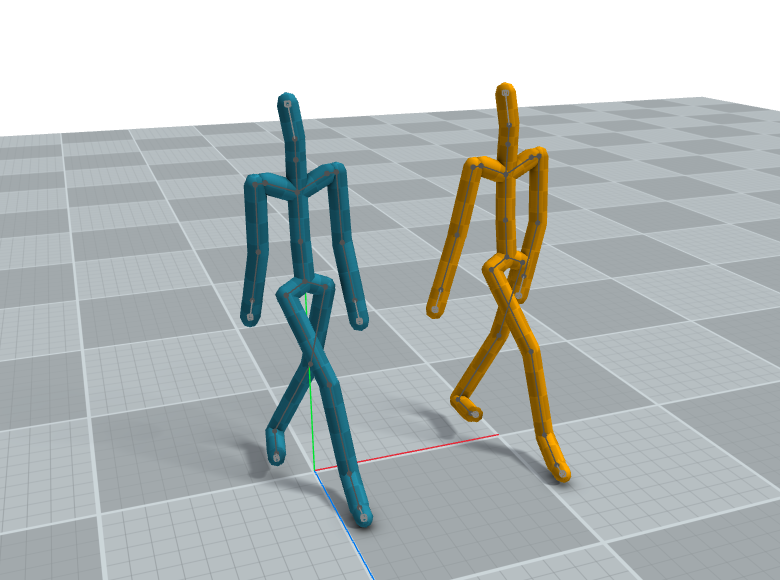
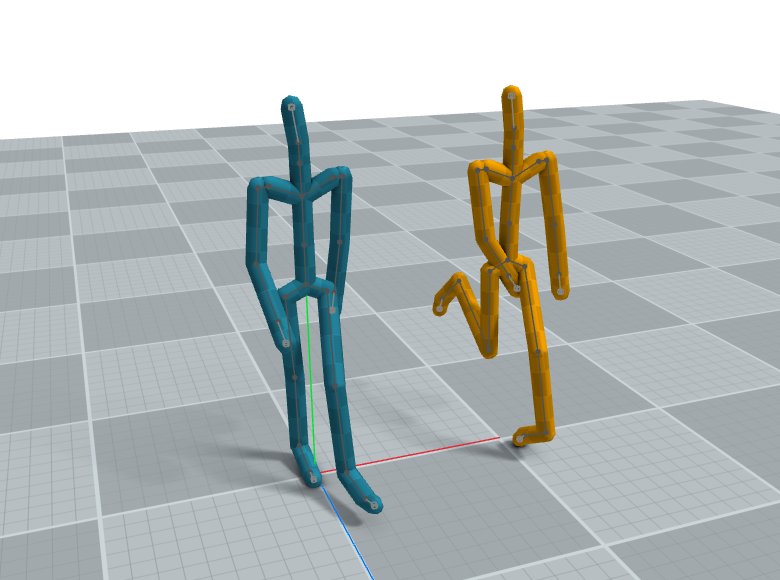
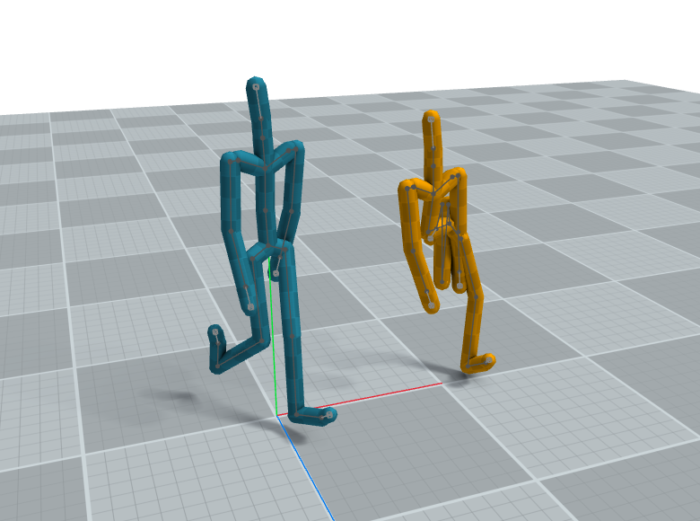
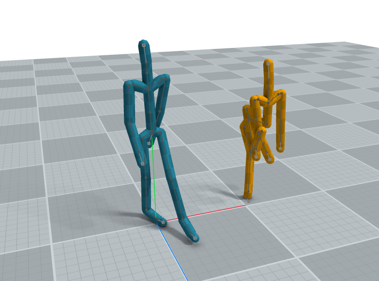
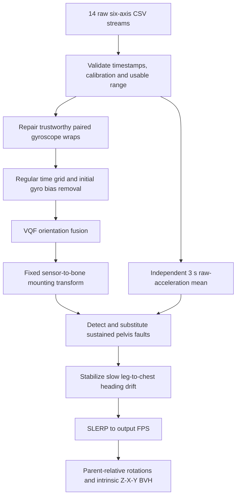

# Six-axis IMU to BVH

**English** | [繁體中文](README.zh-TW.md)

Convert 14 body-mounted accelerometer/gyroscope streams into a BVH skeleton animation, with auditable corrections for a predominantly walking trial. The converter estimates orientations from raw six-axis measurements; it does not reuse previously calculated quaternions or ZUPT labels.

The current **v3** pipeline combines local gyroscope wrap repair, VQF orientation estimation, sensor mounting correction, conservative pelvis substitution, and relative leg-heading stabilization. It aims to improve animation stability and internal consistency. There is no external motion-capture ground truth establishing anatomical accuracy.

## See the correction

**Teal: v3, corrected. Gold: v1, initial reconstruction from raw IMU data.** Gold is a reconstructed animation, not a measured reference skeleton. The v1 → v3 comparison includes the arm mounting correction introduced in v2 and the walking corrections introduced in v3.

| Comparison 1 | Comparison 2 |
| :---: | :---: |
|  |  |
| **Comparison 3** | **Comparison 4** |
|  |  |

These screenshots show differences in arm swing, leg orientation, and trunk posture. All are center-cropped to **780 × 580 pixels**, without scaling or redrawing. Their timestamps were not supplied, so they are visual examples rather than identified gait phases. See [how the corrections work](#how-the-corrections-work) for the assumptions behind these changes.

The independent BVH reader gives the following median **global segment tilt during the last 10 seconds**. Tilt is the angle between the segment's +Y axis and world +Y; it is not joint-angle error against ground truth.

| Segment / BVH joint | v1, before | v3, after |
| --- | ---: | ---: |
| Pelvis / `Hips` | 104.9° | 2.6° — torso approximation |
| Right shank / `RightLeg` | 143.5° | 17.9° |
| Left foot / `LeftFoot` | 87.1° | 17.8° |
| Right foot / `RightFoot` | 91.9° | 15.4° |

These numbers describe reconstruction consistency, not motion-capture accuracy. The pelvis result explicitly includes torso substitution. Definitions and reproduction commands are in [Validation](docs/validation.md).

## Open the BVH in your browser

1. Download [before_v1_x100.bvh](examples/before_v1_x100.bvh) and [after_v3.bvh](examples/after_v3.bvh). On GitHub, download the raw file rather than saving the HTML page.
2. Open the [BVHView online viewer](https://theorangeduck.com/media/uploads/BVHView/bvhview.html).
3. Drag the BVH files onto the viewer to load and play the animations.

The v1 example has **+100 cm added to root X position** for side-by-side viewing; all rotations remain those of v1. This display offset is not a walking trajectory. Screenshot colors identify the supplied captures; a new viewer session may assign colors differently. No raw CSV files or Python installation are needed to view the examples. See [Example files](examples/README.md).

## Install and run

The repository includes the complete **14-file `Edward_field1_raw` recording** (33,663,479 bytes, approximately 33.7 MB), so the default example runs immediately after installation. Clone the project, then create the **Python 3.10** conda environment:

```sh
git clone https://github.com/root50643/imu-gait-correction.git
cd imu-gait-correction
conda env create -f environment.yml
conda activate imu-to-bvh
```

You can also download and extract the repository ZIP from GitHub, then open a terminal in the extracted repository root. Alternatively, use your existing Anaconda `NHRI` environment from that root:

```sh
conda activate NHRI
python -m pip install -r requirements.txt
```

Run the included raw-data example and validate the generated animation:

```sh
python imu_to_bvh.py
python validate_bvh.py outputs/Edward_field1_v3.bvh
```

The converter reads [data/Edward_field1_raw/](data/Edward_field1_raw/) and produces `outputs/Edward_field1_v3.bvh` and `outputs/Edward_field1_v3.report.json`. Drag the generated BVH into [BVHView](https://theorangeduck.com/media/uploads/BVHView/bvhview.html) using the steps above. The report records the processing settings and correction decisions; see [report interpretation](docs/validation.md). Reusing an output path overwrites that BVH and its report; input CSV files are not modified. For another recording, follow [Input data format](docs/data-format.md). Custom recording or output-range commands:

```sh
python imu_to_bvh.py --input-dir data/my_trial --trial my_trial --output outputs/my_trial.bvh
python imu_to_bvh.py --height-cm 170 --fps 30 --output outputs/Edward_30fps.bvh
python imu_to_bvh.py --start 10 --end 30 --output outputs/Edward_10_30.bvh
```

The supplied example has **5,259 frames at 60 FPS**: nominal playback duration 87.65 s, with 87.6333 s between its first and last sample. Calibration uses original timestamps **0–5.145 s**; output samples cover **5.15–92.783333 s**, within the safe motion interval ending at 92.795 s. The pelvis has a repeated six-axis tail from 92.8 s and a later long gap, so conversion ends before those data.

## How the corrections work



These steps describe the implemented defaults. [Algorithm details](docs/algorithms.md) gives full equations, detection rules, and failure behavior; [Parameters](docs/parameters.md) maps CLI options and internal thresholds to their implementation.

### 1. Validate data and repair local angular-rate wraps

The reader rejects non-finite values, duplicate or decreasing timestamps, and invalid calibration flags. It selects the common initial calibration block and ends at the earliest sensor limit: a long gap or a sufficiently long exactly repeated six-axis tail. Short gaps up to `--max-gap 0.05` seconds may be interpolated. Tail detection is a quality heuristic, not proof of corruption or a detector for genuine stillness.

Some angular rates jump between approximately +5.7 and −5.7 rad/s within 5 ms. `gyro_repair.py` treats these as possible numeric wraps. It only changes intervals bounded by adjacent, opposite jumps, at most **0.5 s** apart, when both repaired boundaries become substantially more continuous. The full wrap period is estimated from clean boundary evidence; insufficient evidence falls back to the recording-specific empirical value **11.45 rad/s**. Device encoding has not been confirmed. Isolated or untrustworthy events remain unchanged and are reported. Repair happens before bias removal and interpolation, within continuous original-sample blocks; offsets never accumulate across the recording.

### 2. Estimate initial bias and fuse orientations with VQF

Assuming the initial calibration block is still, its mean angular-rate vector is subtracted as initial gyroscope bias. Acceleration is not demeaned because it provides the gravity reference. VQF estimates residual bias during rest and motion while combining gyroscope integration with acceleration-based inclination correction. See the [VQF documentation](https://vqf.readthedocs.io/en/latest/getting_started.html).

With `--fusion auto`, the pelvis uses forward VQF to avoid propagating its late anomaly backward through fusion; all other sensors use [offlineVQF](https://vqf.readthedocs.io/en/latest/ref_cython_offline.html), which can use future samples. The acceleration filter time constant is **0.5 s for feet**, **3 s elsewhere**. The shorter foot setting improved gravity consistency in raw-signal-selected quasi-static intervals; 0.2 s suppressed too much foot-lift motion and was not selected. This uses the same accelerometers and is not an independent accuracy measurement. The overall correction pipeline remains offline even when fusion is set to `online`.

### 3. Apply fixed mounting and arm orientation corrections

World coordinates use a right-handed frame: **+Y up, +Z forward, +X toward the character's left**. Calibration acceleration defines up; the configured sensor axis projected onto the horizontal plane supplies the assumed forward direction. `mounting.json` uses +z for body segments and +x for feet unless a complete reference quaternion is supplied.

Let $Q(t)$ map sensor coordinates to the fusion frame, $Q_{ref}$ be the mean orientation over the final calibration second, and $R_0$ map the sensor to BVH world in the assumed calibration pose. The bone rotation is:

$$R_{bone}(t)=R_0\,Q_{ref}^{-1}\,Q(t)\,R_0^{-1}.$$

The left upper arm and forearm use **+90°**, and the right upper arm and forearm **−90°**, about world +Y in the fixed mounting transform. This follows the reported outer-arm placement and changes the mapped swing plane. It does not shift movement timing or force opposite arm phases. Other mounting directions remain assumptions to replace with measured calibration when available.

### 4. Detect sustained pelvis disagreement and substitute smoothly

`walking_constraints.py` checks fused gravity directions and an independently computed **3 s mean of raw acceleration**, transformed with the initial mounting frame. Entry requires pelvis tilt above **60°**, disagreement with both torso references above **45°**, and corroborating acceleration evidence while chest and upper back remain upright and agree. The full condition must last **2 s**. A confirmed interval may extend backward by at most **2 s**, only through uninterrupted raw-acceleration evidence.

The replacement follows the chest with a constant heading offset estimated from healthy pre-fault samples, using a **1.5 s** smooth transition. A fixed entry offset avoids reintroducing faulty pelvis spin. Measured chest turns are retained. Recovery requires **2 s** of agreement in both orientation and raw acceleration; shared normal bending can qualify. If chest/upper-back reference quality fails, substitution fades out before the unreliable interval. Here, the strict fault starts at 60.045 s and corroboration permits backtracking to 58.885 s. This is a torso-based pelvis approximation; these data cannot establish whether the cause was sensor slip or an axis/data anomaly.

### 5. Suppress slow relative leg-heading drift

`walking_heading.py` uses the chest as the common heading reference for both thighs, shanks, and feet. Heading comes from the horizontal projection of each segment's +X axis. Reliable observations require a projection magnitude of at least **0.65**, chest tilt at most **25°**, and leg-segment tilt at most **70°**. Reliable calibration samples anchor relative heading; otherwise the first reliable 2 s provide a reported fallback.

The slow relative trend uses a Gaussian filter with **σ = 2 s** and a **±4 s** support window. Bounded unreliable gaps up to 0.5 s are interpolated; longer gaps split filter regions and hold the previous correction. When observations return, correction resumes over 1 s, with a 45°/s rate limit. If $d(t)$ is the gated, smoothed relative-heading change, the correction is:

$$R'_{leg}(t)=R_Y\!\left(-d(t)\right)\,R_{leg}(t).$$

Only world-Y rotation changes, so segment tilt and turns shared with the chest are retained. Heads and arms are not constrained by this step. Sustained sideways walking or persistent external leg rotation can be mistaken for drift; this is a forward-walking assumption, not an absolute heading measurement.

### 6. Export corrected rotations to BVH

Corrections run on the complete fusion grid before SLERP resamples to output FPS. Selecting `--start` crops output without resetting calibration or forgetting an earlier fault. Joint rotations follow:

$$R_{local,j}(t)=R_{global,parent(j)}(t)^{-1}\,R_{global,j}(t).$$

The root uses its global rotation directly. Rotations are written in **intrinsic Z-X-Y order**, in degrees; equivalent Euler representations are selected for continuity and checked by reconstructing rotations. See [SciPy rotation conventions](https://docs.scipy.org/doc/scipy/reference/generated/scipy.spatial.transform.Rotation.as_euler.html) and the [BVH format description](https://research.cs.wisc.edu/graphics/Courses/cs-838-1999/Jeff/BVH.html). Defaults are **60 FPS**, **21 joints**, centimeter units, and a generic **175 cm** N-pose skeleton with fixed root position. No walking displacement or foot-contact correction is reconstructed.

## Settings and controlled comparisons

| Setting | Default | Effect / where to change it |
| --- | --- | --- |
| `--gyro-repair` | `paired` | Local wrap repair; `none` disables it. |
| `--gyro-wrap-period` | automatic | Override full wrap period in rad/s after confirming device encoding. |
| `--initial-bias` | `calibration` | Subtract initial mean gyro; `none` retains VQF residual bias estimation. |
| `--fusion` | `auto` | Pelvis forward, others offline; `online`/`offline` forces one method. |
| `--foot-tau-acc` | `0.5` s | Foot acceleration filter time constant; other segments use 3 s. |
| `--walking-correction` | `full` | `pelvis` disables leg-heading stabilization; `none` disables both walking constraints. |
| `--mounting` | `mounting.json` | Fixed sensor axes, heading offsets, or reference quaternions. |
| Pelvis thresholds | 2 s entry/recovery; 1.5 s blend | `PelvisCorrectionSettings` in `walking_constraints.py`; not CLI flags. |
| Heading smoothing | σ = 2 s | Constants in `walking_heading.py`; not CLI flags. |

The [full parameter reference](docs/parameters.md) also covers units, pose, time range, height, FPS, and internal quality thresholds. `--pose n|t` describes the assumed actual calibration pose; it is not an arbitrary restyling option. Use `--gyro-unit deg/s` or `--accel-unit g` only when those source units are confirmed.

```sh
python imu_to_bvh.py --walking-correction pelvis --output outputs/pelvis_only.bvh
python imu_to_bvh.py --walking-correction none --output outputs/fusion_only.bvh
python imu_to_bvh.py --walking-correction none --gyro-repair none --fusion online --foot-tau-acc 3 --output outputs/v2_baseline_reproduced.bvh
python imu_to_bvh.py --help
```

The last conversion command reproduces a **v2-style baseline**, retaining current ±90° arm mounting; it does not recreate v1. `--walking-correction none` leaves gyro repair and fusion settings active. Use the supplied v1 example for the published before/after comparison.

Each conversion writes an audit JSON report with input ranges, repair events, fusion/mounting settings, pelvis replacement intervals, heading corrections, warnings, and numerical checks. `walking_corrections.pelvis.weight_by_frame` indexes the **fusion grid** in `processing_time_range`, not 60 FPS output frames: 0 is original pelvis, 1 is full substitution progress. Reported tilt is not error against ground truth. See [report interpretation](docs/validation.md).

## Validate and compare

```sh
python -m unittest discover -s tests -v
python validate_bvh.py examples/after_v3.bvh --preview outputs/v3_preview.png
python compare_bvh.py examples/before_v1_x100.bvh examples/after_v3.bvh --before-label "v1 (before)" --after-label "v3 (after)" --output outputs/v1_v3_comparison.png
```

Synthetic tests cover bias, mounting axes, parent/child rotations, Euler continuity, safe time ranges, wrap repair, pelvis fault/recovery behavior, shared turns, and heading quality gaps. The independent reader reconstructs BVH rotations with explicit axis matrices and checks frame/channel counts, bone lengths, and rotation validity. On both Ubuntu and Windows, GitHub Actions also runs the default conversion using the included raw recording and validates the generated BVH. See [Validation](docs/validation.md) for scope and published measurements.

## Assumptions and limits

- Source units are assumed to be seconds, m/s², and rad/s; device documentation has not confirmed them. Large calibration mean angular rates trigger warnings because calibration movement can be mistaken for bias.
- Six-axis fusion has no absolute heading reference. Matching timestamps alone do not verify hardware synchronization; uncertain mounting axes can still produce incorrect anatomy.
- The initial pose is assumed to be standing with arms down. Skeleton dimensions are generic; shoulders, neck, hands, and toes without independent sensors inherit parent orientations.
- Pelvis substitution and leg-heading stabilization encode walking assumptions. Genuine unusual postures, sustained sideways walking, or independent torso/leg headings can be altered.
- Root translation is fixed. Foot sliding, ground penetration, and true travel distance are not solved. SLERP resampling has no additional strict anti-aliasing filter; use higher output FPS when retaining fast motion matters.

## Documentation and repository layout

| English | 繁體中文 |
| --- | --- |
| [Algorithm details](docs/algorithms.md) | [演算法詳解](docs/algorithms.zh-TW.md) |
| [Parameter reference](docs/parameters.md) | [參數說明](docs/parameters.zh-TW.md) |
| [Input data format](docs/data-format.md) | [輸入資料格式](docs/data-format.zh-TW.md) |
| [Validation and reports](docs/validation.md) | [驗證與報告](docs/validation.zh-TW.md) |
| [Example files and playback](examples/README.md) | [範例檔案與播放](examples/README.zh-TW.md) |
| [Repository and release contents](docs/repository.md) | [專案與發布內容](docs/repository.zh-TW.md) |

The root contains the converter and supporting modules. `tests/` holds synthetic and regression tests; `docs/` holds bilingual explanations and shared images; `examples/` holds two BVH demonstrations. The 14 original CSV files in `data/Edward_field1_raw/` are included as a runnable example and retain their original bytes. Other contents of `data/`, generated `outputs/`, local reports/backups, and `tools/bvhview/` remain local-only and excluded from the release. The converter does not depend on the BVHView executable.
