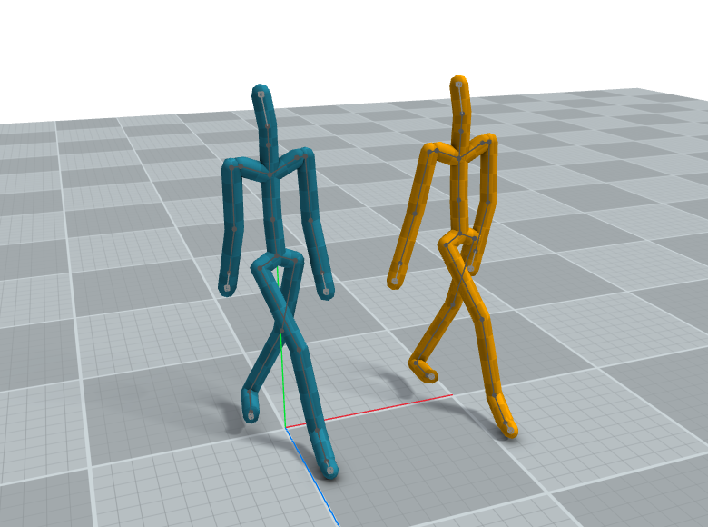
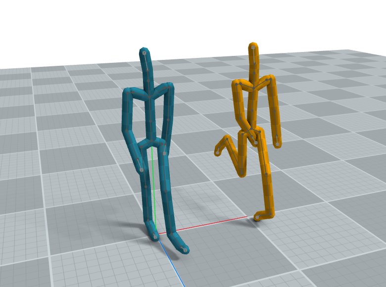
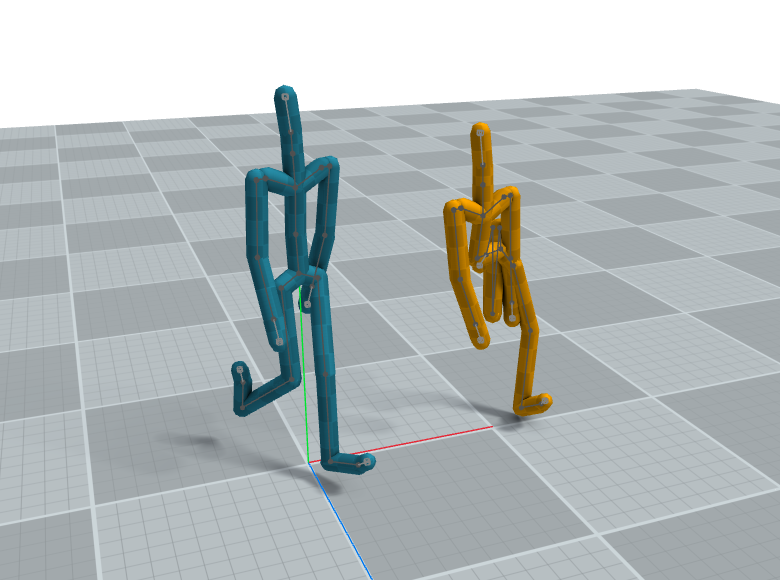
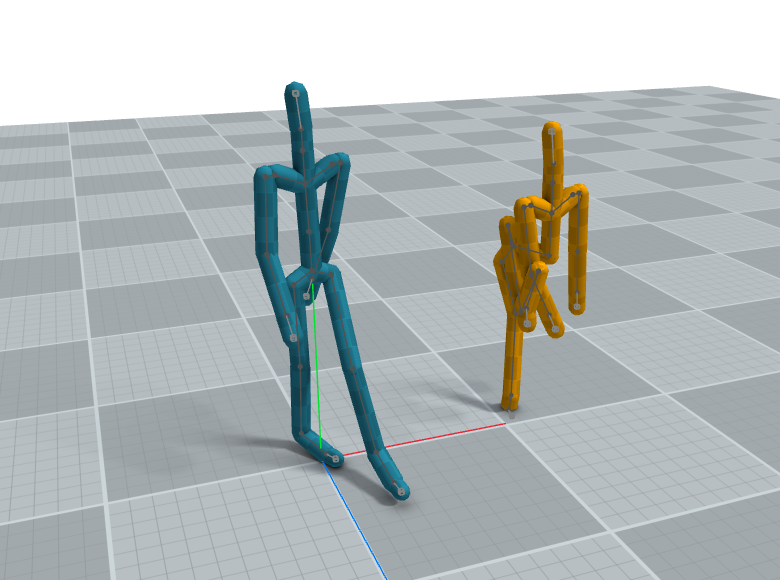
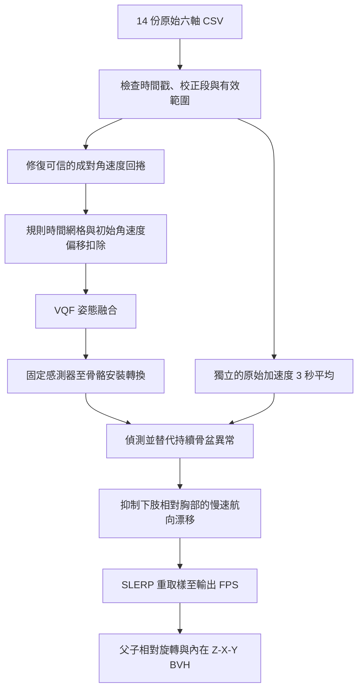

# 六軸 IMU 轉 BVH

[English](README.md) | **繁體中文**

將安裝於 14 個身體部位的加速度計／陀螺儀資料轉成 BVH 骨架動畫，並針對以走路為主的試驗提供可追溯的校正。程式直接由原始六軸量測重新估計姿態，不沿用先前計算的四元數或 ZUPT 標記。

目前的 **v3** 流程結合局部角速度回捲修復、VQF 姿態估計、感測器安裝校正、保守的骨盆替代及下肢相對航向穩定化，目的是改善動畫穩定性與內部一致性。目前沒有外部動作捕捉真值可用來確認解剖姿態的準確度。

## 查看校正效果

**藍綠色：v3 校正後。黃色：由原始 IMU 資料進行的 v1 初版重建。** 黃色是重建動畫，不是實際量測的參考骨架。v1 → v3 比較包含 v2 加入的手臂安裝校正，以及 v3 加入的步行校正。

| 比較圖 1 | 比較圖 2 |
| :---: | :---: |
|  |  |
| **比較圖 3** | **比較圖 4** |
|  |  |

這些截圖呈現手臂擺動、下肢方向與軀幹姿態的差異。圖片均以中心裁切統一為 **780 × 580 像素**，沒有縮放或重繪。由於未提供截圖時間，這些圖片作為視覺範例，不標註特定步態階段。相關變化背後的假設請見[校正方式](#校正方式)。

獨立 BVH 讀取程式計算的**最後 10 秒骨段全域傾斜角中位數**如下。傾斜角是骨段 +Y 軸與世界 +Y 軸的夾角，不是相對真值的關節角誤差。

| 部位／BVH 關節 | v1 校正前 | v3 校正後 |
| --- | ---: | ---: |
| 骨盆／`Hips` | 104.9° | 2.6° — 軀幹推估 |
| 右小腿／`RightLeg` | 143.5° | 17.9° |
| 左腳／`LeftFoot` | 87.1° | 17.8° |
| 右腳／`RightFoot` | 91.9° | 15.4° |

這些數字描述重建的一致性，不是動作捕捉準確率。骨盆結果明確包含軀幹替代。定義與重現命令請見[驗證說明](docs/validation.zh-TW.md)。

## 在瀏覽器開啟 BVH

1. 下載 [before_v1_x100.bvh](examples/before_v1_x100.bvh) 及 [after_v3.bvh](examples/after_v3.bvh)。在 GitHub 請下載原始檔案，不要儲存 HTML 網頁。
2. 開啟 [BVHView 線上檢視器](https://theorangeduck.com/media/uploads/BVHView/bvhview.html)。
3. 將 BVH 檔案拖曳至檢視器，即可載入並播放動畫。

v1 範例的**根節點 X 位置加上 100 cm**，方便並排觀看；所有旋轉仍與 v1 相同。這是展示位移，不是行走軌跡。截圖顏色對應提供的畫面，新開的檢視器可能分配不同顏色。觀看範例不需要原始 CSV，也不需要安裝 Python。請見[範例檔案](examples/README.zh-TW.md)。

## 安裝與執行

儲存庫已包含完整的 **14 份 `Edward_field1_raw` 錄製資料**（33,663,479 位元組，約 33.7 MB），安裝後即可直接執行預設範例。請先複製專案，再建立 **Python 3.10** conda 環境：

```sh
git clone https://github.com/root50643/imu-gait-correction.git
cd imu-gait-correction
conda env create -f environment.yml
conda activate imu-to-bvh
```

也可以從 GitHub 下載並解壓縮儲存庫 ZIP，再於解壓縮後的專案根目錄開啟終端機。若已有 Anaconda `NHRI` 環境，可在該根目錄改用：

```sh
conda activate NHRI
python -m pip install -r requirements.txt
```

執行內附的原始資料範例，並驗證產生的動畫：

```sh
python imu_to_bvh.py
python validate_bvh.py outputs/Edward_field1_v3.bvh
```

轉換程式讀取 [data/Edward_field1_raw/](data/Edward_field1_raw/)，產生 `outputs/Edward_field1_v3.bvh` 與 `outputs/Edward_field1_v3.report.json`。依前述步驟將產生的 BVH 拖曳至 [BVHView](https://theorangeduck.com/media/uploads/BVHView/bvhview.html) 即可觀看。報告記錄處理設定與校正判定，請見[報告解讀](docs/validation.zh-TW.md)。再次使用相同輸出路徑會覆寫 BVH 與報告，不會修改輸入 CSV。使用其他錄製資料時，請依[輸入資料格式](docs/data-format.zh-TW.md)準備。自訂錄製資料或輸出範圍的命令：

```sh
python imu_to_bvh.py --input-dir data/my_trial --trial my_trial --output outputs/my_trial.bvh
python imu_to_bvh.py --height-cm 170 --fps 30 --output outputs/Edward_30fps.bvh
python imu_to_bvh.py --start 10 --end 30 --output outputs/Edward_10_30.bvh
```

提供的範例包含 **5,259 幀、60 FPS**：名目播放長度為 87.65 秒，第一筆至最後一筆取樣相隔 87.6333 秒。校正使用原始時間戳 **0–5.145 秒**；輸出取樣範圍為 **5.15–92.783333 秒**，位於截止至 92.795 秒的安全動作區間內。骨盆從 92.8 秒起出現六軸固定尾值，後續又有長缺口，因此轉換在這些資料之前結束。

## 校正方式



以下說明實作中的預設行為。[演算法詳解](docs/algorithms.zh-TW.md)提供完整公式、偵測規則與失效處理；[參數說明](docs/parameters.zh-TW.md)列出 CLI 選項、內部門檻及其實作位置。

### 1. 資料檢查與局部角速度回捲修復

讀取程式拒絕非有限值、重複或倒退的時間戳，以及不合法的校正標記。它選取共同的開頭校正段，並在最早出現感測器限制的位置結束：長缺口或足夠長的六軸完全相同尾值。`--max-gap 0.05` 秒以下的短缺口可插值補齊。尾值偵測是資料品質啟發式檢查，不是資料損毀的證明，也不是判斷真實靜止的偵測器。

部分角速度會在 5 毫秒內於約 +5.7 與 −5.7 rad/s 間跳變。`gyro_repair.py` 將其視為可能的數值回捲。只有相鄰、方向相反、相隔不超過 **0.5 秒**的兩個跳變，且修復後兩側邊界都明顯更連續時，才修改中間區間。完整回捲週期由乾淨的邊界證據估計；證據不足則使用本資料的經驗值 **11.45 rad/s**。設備編碼尚未確認。孤立或不可信事件保留原值並記錄。修復在扣除偏移與插值之前、於原始取樣的連續區塊中執行，不讓偏移累積至整份錄製資料。

### 2. 初始偏移估計與 VQF 姿態融合

假設開頭校正段靜止，以其平均角速度向量作為初始陀螺儀偏移並扣除。加速度不扣平均值，以保留重力參考。VQF 於靜止與運動期間估計殘餘偏移，同時結合陀螺儀積分與加速度提供的傾斜修正。請見 [VQF 文件](https://vqf.readthedocs.io/en/latest/getting_started.html)。

`--fusion auto` 對骨盆使用正向 VQF，避免後段異常透過融合向前傳遞；其他感測器使用可利用未來取樣的 [offlineVQF](https://vqf.readthedocs.io/en/latest/ref_cython_offline.html)。加速度濾波時間常數為**足部 0.5 秒、其他部位 3 秒**。較短的足部設定在由原始訊號挑選的準靜止片段改善了重力一致性；0.2 秒會過度壓低抬腳動態，因此未採用。這使用同一組加速度計，不是獨立的準確度量測。即使融合設為 `online`，整體校正流程仍是離線處理。

### 3. 固定安裝與手臂方向校正

世界座標採右手系：**+Y 向上、+Z 向前、+X 朝角色左側**。校正段的加速度定義向上方向，設定的感測器軸投影至水平面後，提供假設的前向。若沒有完整參考四元數，`mounting.json` 對身體部位使用 +z，足部使用 +x。

令 $Q(t)$ 將感測器座標轉至融合座標，$Q_{ref}$ 為最後一秒校正段的平均姿態，$R_0$ 為假設校正姿勢下由感測器轉至 BVH 世界的旋轉。骨骼旋轉為：

$$R_{bone}(t)=R_0\,Q_{ref}^{-1}\,Q(t)\,R_0^{-1}.$$

固定安裝轉換中，左上臂與左前臂繞世界 +Y 使用 **+90°**，右上臂與右前臂使用 **−90°**。這依據感測器裝在手臂外側的資訊，改變量測擺動所對應的平面，不會平移動作時間，也不會強迫雙臂具有相反相位。其他安裝方向仍屬假設，有量測校正資料時應予取代。

### 4. 持續骨盆異常偵測與平滑替代

`walking_constraints.py` 同時檢查融合姿態的重力方向，以及經初始安裝座標轉換、獨立計算的**原始加速度 3 秒平均**。啟動條件包含骨盆傾斜超過 **60°**、與兩個軀幹參考的差異超過 **45°**，並有加速度佐證，同時胸部與上背保持大致直立且一致。完整條件必須持續 **2 秒**。確認後的區間最多可向前延伸 **2 秒**，且只能沿著不中斷的原始加速度異常證據回溯。

替代姿態跟隨胸部，並以故障前健康取樣估計的固定航向差對齊，使用 **1.5 秒**平滑過渡。固定的起始相對旋轉可避免重新混入故障骨盆的快速翻轉，胸部量測到的轉彎會保留。恢復需要姿態與原始加速度連續 **2 秒**一致，共同的正常彎腰也可以符合恢復條件。若胸部／上背參考品質失效，替代會在不可信區間開始前逐漸退出。本資料的嚴格異常起點為 60.045 秒，佐證允許回溯至 58.885 秒。這是由軀幹推估骨盆，這些資料無法確定原因是感測器滑動，還是軸向／資料異常。

### 5. 下肢慢速相對航向漂移抑制

`walking_heading.py` 以胸部作為雙側大腿、小腿與足部的共同航向參考。航向取自各骨段 +X 軸的水平投影。可靠觀測要求投影長度至少 **0.65**、胸部傾斜不超過 **25°**、下肢骨段傾斜不超過 **70°**。以可靠校正取樣建立相對航向基準；若沒有，則以最初可靠的 2 秒作為備援並記錄。

慢速相對趨勢使用 **σ = 2 秒**、支援範圍 **±4 秒**的 Gaussian 濾波。兩端有可靠觀測、長度不超過 0.5 秒的不可信缺口可插值；更長的缺口會分開濾波區段，並維持先前修正值。觀測恢復後以 1 秒過渡重新更新，修正速率限制為 45°/秒。若 $d(t)$ 為經可靠度判定與平滑的相對航向變化，校正為：

$$R'_{leg}(t)=R_Y\!\left(-d(t)\right)\,R_{leg}(t).$$

此步驟只改變世界 Y 軸旋轉，因此保留骨段傾斜及與胸部共同的轉彎，不約束頭部與手臂。持續側身走或長時間下肢外旋可能被當成漂移；這是向前走路的假設，不是絕對航向量測。

### 6. 將校正旋轉輸出為 BVH

校正在完整融合網格執行，再由 SLERP 重取樣至輸出 FPS。指定 `--start` 只裁切輸出，不會重設校正基準，也不會忘記更早出現的故障。關節旋轉依下式計算：

$$R_{local,j}(t)=R_{global,parent(j)}(t)^{-1}\,R_{global,j}(t).$$

根節點直接使用全域旋轉。旋轉以**內在 Z-X-Y 順序**、角度制寫入，選取較連續的等價歐拉角表示，並透過重建旋轉驗證。請見 [SciPy 旋轉慣例](https://docs.scipy.org/doc/scipy/reference/generated/scipy.spatial.transform.Rotation.as_euler.html)及 [BVH 格式說明](https://research.cs.wisc.edu/graphics/Courses/cs-838-1999/Jeff/BVH.html)。預設為 **60 FPS、21 個關節**、公分制、通用 **175 cm** 的 N-pose 骨架，根位置固定。尚未重建行走位移或進行腳底接地校正。

## 設定與控制變因比較

| 設定 | 預設值 | 作用／調整位置 |
| --- | --- | --- |
| `--gyro-repair` | `paired` | 局部回捲修復；`none` 關閉。 |
| `--gyro-wrap-period` | 自動 | 確認設備編碼後，以 rad/s 指定完整回捲週期。 |
| `--initial-bias` | `calibration` | 扣除初始平均角速度；`none` 仍保留 VQF 殘餘偏移估計。 |
| `--fusion` | `auto` | 骨盆正向、其他部位離線；`online`／`offline` 強制同一方法。 |
| `--foot-tau-acc` | `0.5` 秒 | 足部加速度濾波時間常數；其他部位使用 3 秒。 |
| `--walking-correction` | `full` | `pelvis` 關閉下肢航向穩定化；`none` 關閉兩項步行約束。 |
| `--mounting` | `mounting.json` | 固定感測器軸向、航向偏移或參考四元數。 |
| 骨盆門檻 | 啟動／恢復 2 秒；過渡 1.5 秒 | `walking_constraints.py` 的 `PelvisCorrectionSettings`；不是 CLI 選項。 |
| 航向平滑 | σ = 2 秒 | `walking_heading.py` 的常數；不是 CLI 選項。 |

[完整參數說明](docs/parameters.zh-TW.md)另涵蓋單位、姿勢、時間範圍、身高、FPS 與內部品質門檻。`--pose n|t` 表示假設的實際校正姿勢，不是任意變換外觀的選項。只有確認來源單位時，才使用 `--gyro-unit deg/s` 或 `--accel-unit g`。

```sh
python imu_to_bvh.py --walking-correction pelvis --output outputs/pelvis_only.bvh
python imu_to_bvh.py --walking-correction none --output outputs/fusion_only.bvh
python imu_to_bvh.py --walking-correction none --gyro-repair none --fusion online --foot-tau-acc 3 --output outputs/v2_baseline_reproduced.bvh
python imu_to_bvh.py --help
```

最後一條轉換命令重現的是 **v2 型態基準**，仍保留目前 ±90° 的手臂安裝設定，不會重建 v1。`--walking-correction none` 仍會保留角速度修復與融合設定。發布的前後比較請使用隨附的 v1 範例。

每次轉換會寫入可追溯的 JSON 報告，包括輸入範圍、修復事件、融合／安裝設定、骨盆替代區間、航向修正、提醒與數值檢查。`walking_corrections.pelvis.weight_by_frame` 對應 `processing_time_range` 中的**融合網格**，不是 60 FPS 輸出幀；0 表示原骨盆，1 表示完全替代的進度。報告中的傾斜角不是相對真值的誤差。請見[報告解讀](docs/validation.zh-TW.md)。

## 驗證與比較

```sh
python -m unittest discover -s tests -v
python validate_bvh.py examples/after_v3.bvh --preview outputs/v3_preview.png
python compare_bvh.py examples/before_v1_x100.bvh examples/after_v3.bvh --before-label "v1 (before)" --after-label "v3 (after)" --output outputs/v1_v3_comparison.png
```

合成資料測試涵蓋偏移、安裝軸向、父子旋轉、歐拉角連續性、安全時間範圍、回捲修復、骨盆故障／恢復行為、共同轉彎及航向品質缺口。獨立讀取程式以明確的軸旋轉矩陣重建 BVH 旋轉，檢查幀數／通道數、骨長與旋轉有效性。GitHub Actions 也會在 Ubuntu 與 Windows 使用內附的原始錄製資料執行預設轉換，並驗證產生的 BVH。驗證範圍及發布量測請見[驗證說明](docs/validation.zh-TW.md)。

## 假設與限制

- 來源單位假設為秒、m/s² 與 rad/s，尚未由設備文件確認。校正平均角速度過大會產生提醒，因為校正時的動作可能被誤認為偏移。
- 六軸融合沒有絕對航向參考。時間戳相同不代表已驗證硬體同步；不確定的安裝軸向仍可能造成錯誤的解剖姿態。
- 初始姿勢假設為站立、雙手自然下垂。骨架尺寸使用通用比例；沒有獨立感測器的肩帶、頸部、手掌及腳趾繼承父節點方向。
- 骨盆替代與下肢航向穩定化使用走路假設，可能改變真實的特殊姿勢、持續側身走，或軀幹與下肢的獨立朝向。
- 根位置固定，尚未解決滑步、穿地或真實移動距離。SLERP 重取樣沒有額外的嚴格反混疊濾波；若需保留快速動作，請提高輸出 FPS。

## 文件與專案配置

| English | 繁體中文 |
| --- | --- |
| [Algorithm details](docs/algorithms.md) | [演算法詳解](docs/algorithms.zh-TW.md) |
| [Parameter reference](docs/parameters.md) | [參數說明](docs/parameters.zh-TW.md) |
| [Input data format](docs/data-format.md) | [輸入資料格式](docs/data-format.zh-TW.md) |
| [Validation and reports](docs/validation.md) | [驗證與報告](docs/validation.zh-TW.md) |
| [Example files and playback](examples/README.md) | [範例檔案與播放](examples/README.zh-TW.md) |
| [Repository and release contents](docs/repository.md) | [專案與發布內容](docs/repository.zh-TW.md) |

根目錄放置轉換程式與支援模組；`tests/` 放置合成與回歸測試；`docs/` 放置雙語說明與共用圖片；`examples/` 放置兩份 BVH 示範。`data/Edward_field1_raw/` 中的 14 份原始 CSV 作為可執行範例隨附，檔案位元組維持原樣。`data/` 的其他內容、產生的 `outputs/`、本機報告／備份及 `tools/bvhview/` 仍僅保留本機並排除發布。轉換程式不依賴 BVHView 執行檔。
