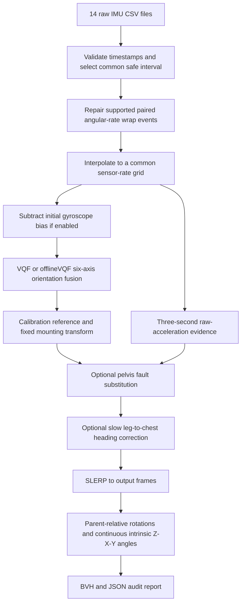

# Correction algorithms

[English](algorithms.md) | [繁體中文](algorithms.zh-TW.md) · [Home](../README.md)

This document describes the implementation in `imu_to_bvh.py`, `gyro_repair.py`, `walking_constraints.py`, and `walking_heading.py`. The converter reconstructs orientation from six-axis IMU measurements. It does not read the previously processed quaternions or ZUPT labels, and it does not recover a measured trajectory or anatomical joint-angle ground truth.

See [input data](data-format.md), [parameters and reports](parameters.md), and [validation](validation.md) for the corresponding interfaces and evidence.

## Processing sequence

The full fusion grid includes the leading calibration interval. Walking corrections run on that grid before the requested output crop and frame-rate conversion. A later `--start` therefore retains earlier calibration, drift history, and an already detected pelvis fault. A shorter `--end` can change acausal estimates because less future data is available.

## 1. Data checks and safe time range

Each file must contain finite numeric measurements and strictly increasing timestamps, with one leading calibration block lasting at least 0.5 seconds followed by motion. The 14 median sample intervals must agree; unequal rates must be resampled explicitly before conversion. Matching timestamps are an assumption of synchronization, not proof of hardware synchronization.

For each sensor, the safe endpoint is the earliest of its file end, the sample preceding the first interval greater than `--max-gap` (default 0.05 seconds), or the sample preceding an exactly repeated six-axis tail. A tail is excluded only when its identical final vector repeats at least `max(10, ceil(0.05 / dt))` times. This is an exact-value data-quality heuristic: genuine rest is not removed merely for low variance. A long gap inside calibration or no usable motion causes an error.

The common endpoint is the minimum of the 14 safe endpoints. The fusion grid uses the common median interval, approximately 200 Hz for this trial. Acceleration and the repaired angular rates are linearly interpolated onto this grid; long gaps are not bridged. The selected output must contain at least two frames. `--start` and `--end` are original timestamps in seconds, not elapsed animation times.

## 2. Local paired angular-rate wrap repair

Several raw lower-limb channels jump between approximately +5.7 and −5.7 rad/s in one 5 ms sample. The algorithm treats sufficiently supported events as a wrapped **rate value**. This is a data-derived hypothesis; the device encoding and full-scale range have not been independently confirmed. This operation is not a `2π` angle unwrap or cumulative integration correction.

Repairs run on the original, unit-converted gyroscope samples before interpolation and initial bias subtraction. Samples are split into continuous blocks at gaps greater than `1.5 × dt`, so repairs cannot pair events across missing samples. Raw CSV files remain unchanged.

For a proposed full wrap span `P`, a candidate boundary requires all three conditions:

- The adjacent rate samples have opposite signs.
- The jump exceeds `0.70 × P`.
- Both sample magnitudes exceed `0.35 × P`.

Without `--gyro-wrap-period`, the code estimates `P` separately for each continuous block. It removes an estimated local slope from candidate jump heights, using same-sign neighboring slopes with magnitudes between 0.005 and 0.6 rad/s per sample. Candidate spans must lie strictly between 10.5 and 12.0 rad/s. At least 12 estimates with interquartile width no greater than 0.25 rad/s permit their median; otherwise the code uses the explicitly reported empirical fallback **11.45 rad/s**. The CLI override is a full span in rad/s, even if input units are deg/s.

Only adjacent candidate boundaries of opposite jump sign, separated by at most **0.5 seconds**, can be paired. The enclosed samples receive one constant `+P` or `−P`, and the signal returns exactly to its original values outside that interval. Acceptance additionally requires:

- Both corrected boundary jumps are at most `min(0.20 × P, max(1.5, 300 × dt))` rad/s and each is less than 25% of its original jump.
- Every corrected rate magnitude in the interval is at most `1.35 × P`.
- The sensor sample rate is at least 50 Hz.

Unpaired or ambiguous events are left unchanged and reported. This conservative repair cannot recover clipping, arbitrary corruption, missing samples, or an unknown sequence of multiple wraps.

## 3. Initial bias and six-axis VQF fusion

With `--initial-bias calibration`, the mean gyroscope vector over the common calibration interval is subtracted from every rate sample. This assumes actual stillness; movement during calibration can be mistaken for bias. A mean-vector norm above 5 deg/s generates a warning to check stillness, units, and bias. Acceleration is not mean-subtracted because its gravity component is needed. `--initial-bias none` disables only this initial subtraction.

VQF integrates angular velocity, corrects inclination using acceleration, and estimates residual gyroscope bias during rest and motion. This project supplies no magnetometer and uses `quat6D`, so heading has no absolute reference. The external algorithm is described in the [VQF paper](https://doi.org/10.1016/j.inffus.2022.10.014) and [official VQF API](https://vqf.readthedocs.io/en/latest/ref_cython.html).

The default `--fusion auto` uses forward `VQF(...).updateBatch(...)` for the pelvis, limiting backward propagation of the later pelvis anomaly through the orientation filter. The other 13 sensors use `offlineVQF`, which uses the whole available sequence, including future samples. See the [official offlineVQF API](https://vqf.readthedocs.io/en/latest/ref_cython_offline.html). The pelvis's calibration reference, raw-acceleration evidence, fault analysis, and heading regularization still use offline processing: `--fusion online` does **not** turn this application into a streaming converter.

The accelerometer low-pass time constant `tauAcc` is **0.5 seconds for both feet** and **3 seconds elsewhere**. The shorter foot setting was selected from local comparisons of gravity consistency during candidate quasi-static intervals; it reduces persistent foot inclination without the stronger suppression of lifting motion observed with 0.2 seconds. Those intervals and their reference gravity come from the same IMU signals, so this supports internal consistency rather than independent accuracy. Selection details are in [validation](validation.md). Other VQF settings retain the installed library defaults.

## 4. Calibration and sensor-to-bone mounting

The BVH world is right-handed: **+Y up, +Z forward, +X toward the character's left**. Let `R0` map initial sensor coordinates to the assumed BVH calibration frame. Its vertical axis comes from mean calibration acceleration. The configured `forward_axis` is projected perpendicular to vertical and normalized; their cross product defines the left axis. The three basis vectors form the rows of the sensor-to-world matrix. `heading_deg` then left-multiplies a right-handed world +Y rotation.

In the supplied `mounting.json`, the left upper arm and forearm use **+90°**; the right upper arm and forearm use **−90°**, following the reported outside-arm placement. Both segments on each arm are adjusted together. This changes the mapping of measured rotation axes to the skeleton and its swing plane. It preserves the measured motion timing; it neither swaps samples nor forces opposite left/right phases. The other headings and forward axes remain mounting assumptions, not measured anatomical calibration.

Let `Q(t)` be the fused sensor rotation, `Qref` the SciPy rotation mean over the final calibration second, and `Rbone(t)` the world orientation of the bone. The implementation uses:

$$
R_{\mathrm{bone}}(t)=R_0\,Q_{\mathrm{ref}}^{-1}\,Q(t)\,R_0^{-1}.
$$

The last factor is the fixed sensor-to-bone mounting correction; it is not an extra animated joint rotation. In the assumed calibration pose the bone rotations are identity and the skeleton offsets define the rest pose. Quaternion composition and fixed coordinate-frame changes follow the [VQF coordinate conventions](https://vqf.readthedocs.io/en/latest/faq.html).

A known complete mounting transform can instead be provided as `reference_sensor_to_world_wxyz`. It overrides that sensor's axis/heading construction. VQF and this configuration use `[w,x,y,z]`; SciPy calls in this code explicitly reorder to `[x,y,z,w]`. The identity example means sensor axes already match the BVH world, and is not a universal mounting setting.

## 5. Pelvis anomaly detection and torso substitution

This walking-specific heuristic distinguishes a sustained pelvis disagreement from ordinary heading drift. It compares both fused orientation and a second signal path from raw acceleration. The second path is independent of gyroscope integration, but **it uses the same IMUs, not an external measurement**.

For each pelvis/chest/upper-back sensor, a three-second moving mean of raw acceleration is transformed by `R0` and normalized. Fused gravity in each calibration bone frame is `R⁻¹ × [0,1,0]`; unlike an Euler yaw comparison, this remains unchanged under any left-multiplied world heading. A common turn therefore cannot trigger the detector by itself.

Entry requires all conditions continuously for **2 seconds**:

- Pelvis fused tilt exceeds 60° and differs from both torso gravity directions by more than 45°.
- Chest and upper back each tilt less than 25° and agree within 15°.
- The raw-acceleration pathway also gives chest/back tilts below 25° and agreement within 15°, while pelvis tilt exceeds 50° and differs from each torso direction by more than 40°.

Once confirmed, a fault stays active through brief crossings below the entry thresholds. Recovery requires two seconds of reliable torso reference plus either an upright pelvis consistent with both torso sensors, or agreement of all three during a common pose such as a bend. Exact recovery thresholds are listed in [parameters](parameters.md).

The confirmed onset may extend backward by at most **2 seconds**, only through uninterrupted preceding acceleration evidence: pelvis acceleration tilt above 30°, differences from both torso sensors above 25°, and healthy torso references. No confirmed fault means no backtracking. Because the three-second acceleration average also uses neighboring future samples, this is a bounded offline inference, not a measured instant of sensor slip.

During a fault the target is the chest orientation with a constant pre-fault pelvis-to-chest heading offset:

$$
T(t)=R_Y(\delta)R_{\mathrm{chest}}(t).
$$

The offset is a robust circular estimate from healthy earlier samples: normally a ten-second window ending three seconds before the fault, otherwise any healthy pre-fault samples, and finally zero under the shared calibration assumption if no such samples exist. Keeping `δ` constant preserves chest turns throughout the replacement.

At entry time `ta`, the fixed relative rotation vector is `v = log(T(ta)⁻¹ Rpelvis(ta))`. A smoothstep `s(u)=u²(3−2u)`, with `u` clamped from 0 to 1 over **1.5 seconds**, gives:

$$
R_{\mathrm{out}}(t)=T(t)\exp\!\left((1-s(u))v\right).
$$

This quaternion-geodesic transition matches the original entry pose while following chest turning. It does not repeatedly blend new, potentially spinning faulty pelvis samples. Exit uses an analogous fixed offset relative to the recovered pelvis. If chest/back references become unreliable, the substitution weight fades out before the unreliable interval and returns gradually afterward; invalid chest orientation is not applied as the target in that interval. The original pelvis may remain poor during such unavailable-reference intervals.

Only the pelvis is replaced here. The result is explicitly a **torso-based approximation of pelvis orientation**, not recovery of true pelvis motion or definitive proof of sensor slip.

## 6. Slow relative leg-heading stabilization

For each thigh, shank, and foot, the method measures heading from the horizontal projection of the bone's +X axis. It forms the wrapped leg-minus-chest heading `h(t)` and excludes unreliable observations before phase unwrapping. Chest tilt must be at most 25°, leg tilt at most 70°, and each +X horizontal projection must have length at least 0.65.

Only bounded internal invalid gaps of at most **0.5 seconds** are linearly interpolated. Longer or unbounded gaps split the supported smoothing regions. Each supported region is Gaussian-smoothed with **σ = 2 seconds**, `truncate=2`, giving approximately **±4 seconds** of support. The baseline `h0` is the median measured, valid calibration heading, rather than a smoothed value contaminated by later samples. If no valid calibration observation exists, valid observations within two elapsed seconds of the first valid sample supply a reported fallback; this does not require two continuous seconds of valid observations.

The desired correction is the smoothed relative heading minus that baseline. In the following formula, `c(t)` is this correction after rate limiting and recovery handling:

$$
c_{\mathrm{desired}}(t)=G_{\sigma}*h(t)-h_0,
\qquad
R'_{\mathrm{leg}}(t)=R_Y(-c(t))R_{\mathrm{leg}}(t).
$$

Correction change is limited to **45 deg/s**. It is held constant throughout unsupported gaps, starting at zero if no earlier estimate exists, and eases back over **1 second** when observations resume. A segment with no valid observation is unchanged.

Left multiplication by world-Y rotation leaves the bone's gravity tilt unchanged. A turn shared with the chest cancels in the relative heading, so this is not a fixed-global-heading constraint. The method suppresses slow relative motion under a forward-walking assumption: sustained sideways walking, persistent hip/foot external rotation, or a sustained chest/leg heading difference can be wrongly removed. It is not a magnetic heading estimate, a knee hinge model, or an anatomical joint-limit solver. The head and arms are excluded.

## 7. BVH sampling and local rotations

After corrections, SciPy [SLERP](https://docs.scipy.org/doc/scipy-1.15.3/reference/generated/scipy.spatial.transform.Slerp.html) samples global orientations at the requested frame times. The default is 60 FPS. For a parent `p` and child `j`:

$$
R_{j,\mathrm{local}}=R_{p,\mathrm{global}}^{-1}R_{j,\mathrm{global}}.
$$

The root uses its global pelvis rotation. The 21-joint skeleton uses standard proportions scaled to the requested height, default 175 cm. Unsensed neck, shoulder, hand, and toe joints inherit parent orientation. Root translation remains fixed at standing height; no double integration, ZUPT position update, inverse kinematics, or foot-contact correction is performed.

The file declares root positions followed by intrinsic `Zrotation Xrotation Yrotation`, in degrees, and the same three rotation channels for other joints. Equivalent Euler branches are selected near the preceding frame and full turns are unwrapped to improve continuity. This does not change the represented rotation. Gimbal-lock warnings remain visible in the report. The writer rounds to eight decimals, restores the rotations, and rejects a maximum round-trip error greater than `1e-6` radians. An independent parser performs additional file and forward-kinematics checks. See [SciPy Euler conventions](https://docs.scipy.org/doc/scipy-1.15.3/reference/generated/scipy.spatial.transform.Rotation.as_euler.html) and the [BVH format reference](https://research.cs.wisc.edu/graphics/Courses/cs-838-1999/Jeff/BVH.html).

## Interpretation and limits

The corrections address separate failure modes: angular-rate discontinuities, mounting-axis mismatch, inclination inconsistency, a suspected pelvis fault, and relative heading drift. Improved screenshots or lower tilt values do not establish motion-capture accuracy. In particular, the pelvis replacement deliberately introduces a torso-motion assumption.

Six-axis measurements cannot establish absolute heading here. Source units, sensor synchronization, initial stillness, mounting axes, and body dimensions need independent confirmation for quantitative use. Genuine unusual postures can resemble faults; acceleration during walking can bias a gravity estimate. The fixed root and unconstrained contacts permit sliding or ground penetration. Read the report alongside the animation, and preserve the original inputs for comparison.
