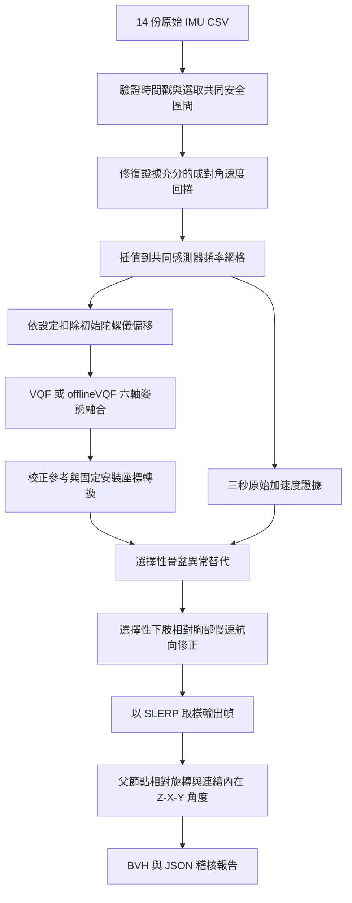

# 校正演算法

[English](algorithms.md) | [繁體中文](algorithms.zh-TW.md) · [首頁](../README.zh-TW.md)

本文說明 `imu_to_bvh.py`、`gyro_repair.py`、`walking_constraints.py` 與 `walking_heading.py` 的實作。轉換器從六軸 IMU 量測重新估計姿態，不讀取先前處理的四元數或 ZUPT 標記，也不會還原實際量測的移動軌跡或解剖關節角真值。

對應介面及驗證依據請見[輸入資料](data-format.zh-TW.md)、[參數與報告](parameters.zh-TW.md)及[驗證](validation.zh-TW.md)。

## 處理順序

完整融合網格包含開頭校正段。步行校正在這個網格上完成後，才裁切使用者指定的輸出區間及轉換幀率。因此，較晚的 `--start` 仍保留先前的校正、漂移歷史及已偵測到的骨盆異常。縮短 `--end` 則可能改變非因果估計，因為可用的未來資料減少。

## 1. 資料檢查與安全時間範圍

每份檔案的量測必須是有限數值，時間戳必須嚴格遞增；開頭須有單一、至少 0.5 秒的校正段，後面接續動作資料。14 個感測器的取樣間隔中位數必須一致；頻率不同時，須先自行明確重取樣。時間戳一致是同步假設，不代表硬體同步已獲驗證。

每個感測器的安全終點取下列三者最早者：檔案結尾、第一個超過 `--max-gap` 間隔之前的樣本（預設門檻 0.05 秒），或六軸完全相同的尾端區塊之前的樣本。只有最後相同向量連續重複至少 `max(10, ceil(0.05 / dt))` 次才排除尾端。這是依完全相同數值判定的資料品質啟發式，不會僅因低變異就刪除真正靜止的資料。校正段內有長缺口，或沒有可用動作時會報錯。

共同終點是 14 個安全終點的最小值。融合網格使用共同取樣間隔中位數，本次資料約為 200 Hz。加速度及修復後角速度以線性插值對齊，不跨越長缺口。選定輸出必須至少包含兩幀。`--start` 與 `--end` 是以秒表示的原始時間戳，不是動畫播放經過時間。

## 2. 局部成對角速度回捲修復

數個下肢原始通道會在單一 5 ms 取樣間隔內，於約 +5.7 與 −5.7 rad/s 之間跳變。演算法將證據充分的事件視為**角速度數值**回捲。這是從資料推定的假設，設備編碼及完整量測範圍尚未獨立確認。這個步驟不是 `2π` 角度展開，也不是累積積分校正。

修復作用在完成單位換算的原始陀螺儀樣本上，早於插值及初始偏移扣除。大於 `1.5 × dt` 的缺口會將資料切成連續區塊，因此不會把缺失樣本兩側的事件配成一對。原始 CSV 保持不變。

對候選完整回捲週期 `P`，候選邊界須同時符合：

- 相鄰角速度樣本的符號相反。
- 跳變量大於 `0.70 × P`。
- 兩個樣本的絕對值皆大於 `0.35 × P`。

沒有指定 `--gyro-wrap-period` 時，程式會對每個連續區塊分別估計 `P`。估計時從候選跳變高度扣除局部斜率；使用的前後相鄰斜率必須同號，大小介於每樣本 0.005 至 0.6 rad/s。候選週期須嚴格介於 10.5 與 12.0 rad/s。至少取得 12 筆估計，且四分位距不超過 0.25 rad/s 時，採其中位數；否則使用並明確記錄本資料的經驗備援值 **11.45 rad/s**。CLI 覆寫值永遠是以 rad/s 表示的完整週期，即使輸入單位是 deg/s 亦同。

只有相鄰候選邊界的跳變方向相反，且相隔不超過 **0.5 秒**，才可能成對修復。區間內樣本加上固定 `+P` 或 `−P`，區間外完全回到原始數值。另外還須符合：

- 修復後兩個邊界跳變皆不超過 `min(0.20 × P, max(1.5, 300 × dt))` rad/s，且各自小於原始跳變的 25%。
- 區間內每個修復後角速度絕對值皆不超過 `1.35 × P`。
- 感測器取樣率至少為 50 Hz。

孤立或不明確的事件保持原值並列入報告。這種保守修復無法還原截幅、任意資料毀損、缺失樣本或次數未知的多重回捲。

## 3. 初始偏移與六軸 VQF 融合

使用 `--initial-bias calibration` 時，程式將共同校正段的陀螺儀向量平均值，從每個角速度樣本扣除。這假設當時確實靜止；校正時的動作可能被誤認為偏移。平均向量模長超過 5 deg/s 時，程式提醒檢查靜止狀態、單位及偏移。加速度不扣除平均值，因為仍需要其中的重力成分。`--initial-bias none` 只關閉這項初始扣除。

VQF 積分角速度，以加速度修正傾斜，並在靜止與運動期間估計殘餘陀螺儀偏移。本專案沒有提供磁力計，使用的是 `quat6D`，因此沒有絕對航向參考。外部演算法可參考 [VQF 論文](https://doi.org/10.1016/j.inffus.2022.10.014)及[官方 VQF API](https://vqf.readthedocs.io/en/latest/ref_cython.html)。

預設 `--fusion auto` 對骨盆採用正向 `VQF(...).updateBatch(...)`，限制後段骨盆異常經由姿態濾波器向前影響估計。其餘 13 個感測器採用 `offlineVQF`，使用完整可用序列，包含未來樣本；請見[官方 offlineVQF API](https://vqf.readthedocs.io/en/latest/ref_cython_offline.html)。骨盆的校正參考、原始加速度證據、異常分析及航向約束仍採用離線處理，因此 `--fusion online` **不會**讓整個應用程式變成串流轉換器。

加速度低通時間常數 `tauAcc` 為**雙腳 0.5 秒、其餘部位 3 秒**。足部較短的設定來自本機候選準靜止區段的重力一致性比較；它能減少足部持續傾斜，又避免使用 0.2 秒時觀察到的抬腳動作過度壓低。這些區段與重力參考來自同一組 IMU，因此支持的是內部一致性，而非獨立準確度。參數選擇細節見[驗證](validation.zh-TW.md)。其他 VQF 設定維持安裝版本的預設值。

## 4. 校正參考與感測器到骨骼的安裝轉換

BVH 世界座標為右手系：**+Y 向上、+Z 向前、+X 朝角色左側**。令 `R0` 將初始感測器座標映射到假設的 BVH 校正座標。垂直軸由校正段平均加速度定義；設定的 `forward_axis` 投影至垂直軸的正交平面並正規化後，與垂直軸的外積定義左向軸。這三個基底向量構成感測器到世界旋轉矩陣的三個列。接著以 `heading_deg` 左乘右手正方向的世界 +Y 旋轉。

所附 `mounting.json` 依據感測器安裝在手臂外側的資訊，將左上臂與左前臂設為 **+90°**，右上臂與右前臂設為 **−90°**。同側兩段一起修正。這會改變量測旋轉軸映射到骨架的方式及擺動平面，保留原始動作時間，不交換樣本，也不強制左右手變成相反相位。其他航向及前向軸仍是安裝假設，並非實測解剖標定。

令 `Q(t)` 為融合的感測器旋轉、`Qref` 為校正最後一秒的 SciPy 旋轉平均值、`Rbone(t)` 為骨段世界姿態，程式使用：

$$
R_{\mathrm{bone}}(t)=R_0\,Q_{\mathrm{ref}}^{-1}\,Q(t)\,R_0^{-1}.
$$

最後一項是固定的感測器到骨骼安裝修正，不是額外加入的動態關節旋轉。在假設校正姿勢中，骨段旋轉為單位旋轉，休息姿勢由骨架偏移定義。四元數合成及固定座標轉換可參考 [VQF 座標慣例](https://vqf.readthedocs.io/en/latest/faq.html)。

已知完整安裝旋轉時，可改以 `reference_sensor_to_world_wxyz` 提供，取代該感測器的軸向與航向構建。VQF 及此設定採 `[w,x,y,z]`，本程式呼叫 SciPy 時明確重排為 `[x,y,z,w]`。單位四元數範例表示感測器軸已和 BVH 世界對齊，不能當作所有感測器通用的安裝設定。

## 5. 骨盆異常偵測與軀幹替代

這個步行專用啟發式方法，將持續骨盆不一致與一般航向漂移區分。它同時比較融合姿態，以及另一條由原始加速度建立的訊號路徑。後者獨立於陀螺儀積分，但**仍使用相同 IMU，不是外部量測**。

對骨盆、胸部與上背，分別將原始加速度作三秒移動平均，再以 `R0` 轉換並正規化。融合姿態在各校正骨段座標下的重力方向為 `R⁻¹ × [0,1,0]`；與比較歐拉航向角不同，它不受任意左乘世界航向影響，因此單純共同轉彎不會啟動偵測器。

進入異常狀態須連續 **2 秒**滿足所有條件：

- 骨盆融合傾斜超過 60°，且與兩個軀幹重力方向各差超過 45°。
- 胸部及上背各自傾斜小於 25°，兩者差異小於 15°。
- 原始加速度路徑同樣顯示胸部／上背各傾斜小於 25°、彼此差異小於 15°；骨盆傾斜則超過 50°，且與兩個軀幹方向各差超過 40°。

異常確認後，不會因短暫低於進入門檻就退出。恢復須有兩秒可靠軀幹參考，並且骨盆直立且與兩個軀幹感測器一致，或三者在共同姿態（例如彎腰）中一致。完整恢復門檻見[參數](parameters.zh-TW.md)。

已確認的起點最多向前延伸 **2 秒**，但僅能沿著連續的前段加速度證據回溯：骨盆加速度傾斜超過 30°、與兩個軀幹方向各差超過 25°，且軀幹參考健康。沒有已確認異常就不回溯。由於三秒加速度平均也使用鄰近未來樣本，這是有範圍限制的離線推論，不是實際量測到的感測器滑動時刻。

異常期間的目標姿態，是胸部旋轉加上故障前固定的骨盆對胸部航向差：

$$
T(t)=R_Y(\delta)R_{\mathrm{chest}}(t).
$$

這個航向差使用先前健康樣本作穩健圓周估計：通常取故障前三秒結束的十秒視窗；不足時使用任何更早的健康樣本；完全沒有健康樣本時，依共同校正假設取零。`δ` 保持固定，使替代過程保留胸部轉彎。

在進入時間 `ta`，固定相對旋轉向量為 `v = log(T(ta)⁻¹ Rpelvis(ta))`。令 `u` 在 **1.5 秒**內從 0 增加到 1 並限制於此範圍，以 smoothstep `s(u)=u²(3−2u)` 得到：

$$
R_{\mathrm{out}}(t)=T(t)\exp\!\left((1-s(u))v\right).
$$

這個四元數測地線過渡在起點吻合原始姿態，同時跟隨胸部轉彎，不反覆混入之後可能快速翻轉的故障骨盆樣本。退出時，以恢復的骨盆為參考採類似固定偏移。若胸部／上背參考變得不可信，替代權重在不可信區間之前淡出，之後再逐漸恢復；不會將該區間無效胸部姿態套用為目標。參考不可用期間，原始骨盆仍可能不正確。

這個步驟只替代骨盆。輸出明確屬於**以軀幹推估的骨盆姿態**，不是恢復骨盆真實動作，也不是感測器滑動的確證。

## 6. 下肢慢速相對航向穩定

對每個大腿、小腿及足部，以骨段 +X 軸的水平投影估計航向，形成限制在一圈內的「下肢減胸部」航向 `h(t)`，並在角度展開前排除不可靠觀測。胸部傾斜須不超過 25°、下肢傾斜不超過 70°，而且兩者 +X 軸水平投影長度皆至少 0.65。

僅對前後有有效觀測、且長度不超過 **0.5 秒**的內部無效區間作線性插值。更長或沒有兩側界限的缺口將有效平滑區間分開。每個有效區間採 Gaussian 平滑，**σ = 2 秒**、`truncate=2`，影響範圍約為 **±4 秒**。基準 `h0` 是有效校正段實測航向的中位數，不使用可能受未來資料影響的平滑值。沒有有效校正觀測時，使用第一筆有效取樣起算兩秒內的有效觀測，並在報告註明備援來源；這不要求連續兩秒都有有效觀測。

目標修正量是平滑後相對航向減去基準。下式中的 `c(t)` 是經變化速率限制及恢復處理後的修正量：

$$
c_{\mathrm{desired}}(t)=G_{\sigma}*h(t)-h_0,
\qquad
R'_{\mathrm{leg}}(t)=R_Y(-c(t))R_{\mathrm{leg}}(t).
$$

修正變化限制為 **45 deg/s**。沒有支援觀測的缺口期間維持前值；沒有更早估計時從零開始；觀測恢復後以 **1 秒**平滑重新追蹤。完全沒有有效觀測的骨段保持不變。

左乘世界 Y 軸旋轉不改變骨段的重力傾斜。與胸部共同的轉彎會在相對航向中抵消，因此不是將全身固定朝向。此方法依正常向前步行假設抑制慢速相對動作，可能錯誤移除持續側身走、長時間髖／足外旋，或持續的胸腿朝向差。它不是磁力航向估計、膝關節鉸鏈模型或解剖關節限制求解器。頭部與手臂不套用此校正。

## 7. BVH 取樣與局部旋轉

完成校正後，以 SciPy [SLERP](https://docs.scipy.org/doc/scipy-1.15.3/reference/generated/scipy.spatial.transform.Slerp.html) 在要求的幀時間取樣全域姿態，預設為 60 FPS。父節點 `p` 與子節點 `j` 的關係為：

$$
R_{j,\mathrm{local}}=R_{p,\mathrm{global}}^{-1}R_{j,\mathrm{global}}.
$$

根節點直接使用全域骨盆旋轉。21 關節骨架使用標準比例，再依指定身高縮放，預設 175 cm。沒有感測器的頸部、肩部、手掌及腳趾繼承父節點方向。根位置固定於站立高度；沒有加速度雙重積分、ZUPT 位置更新、反向運動學或腳底接觸修正。

檔案在根位置之後宣告內在 `Zrotation Xrotation Yrotation`，角度單位為度，其他關節也使用相同三個旋轉通道。程式選擇與前一幀接近的等價歐拉角分支，並展開整圈旋轉以改善連續性，不改變實際表示的旋轉。萬向節鎖定警告保留於報告。寫檔器四捨五入至小數八位後還原旋轉，若最大往返誤差大於 `1e-6` radian 則拒絕輸出。獨立解析器另執行檔案與前向運動學檢查。請見 [SciPy 歐拉角慣例](https://docs.scipy.org/doc/scipy-1.15.3/reference/generated/scipy.spatial.transform.Rotation.as_euler.html)及 [BVH 格式參考](https://research.cs.wisc.edu/graphics/Courses/cs-838-1999/Jeff/BVH.html)。

## 解讀與限制

各項校正處理不同問題：角速度不連續、安裝軸向不一致、傾斜不一致、疑似骨盆故障及相對航向漂移。截圖改善或傾斜數值下降不能證明動作捕捉準確度；尤其骨盆替代明確引入了軀幹動作假設。

本流程的六軸量測無法建立絕對航向。若要做定量用途，來源單位、感測器同步、初始靜止、安裝軸向及身體尺寸都需要獨立確認。真實特殊姿勢可能類似故障，步行加速度也可能偏移重力估計。固定根位置與未限制的接觸允許滑步或穿地。請將報告與動畫一起檢視，並保留原始輸入供比較。
